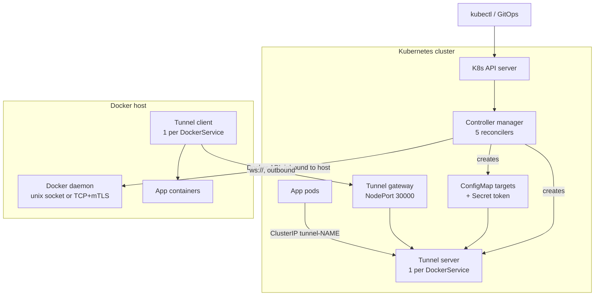
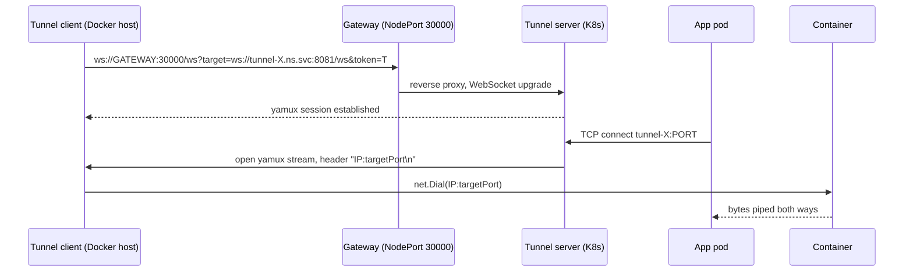

# Architecture (current state)

This document describes how the operator works **today** (as of commit `ba96abf`), the gaps we know about, and the worst-case failure scenarios that follow from them. The proposed next architecture is in [design/agent-hub.md](design/agent-hub.md).

## Components

| Component | Runs where | Code | Role |
|---|---|---|---|
| Controller manager | K8s, `system` namespace | `cmd/manager`, `internal/controller/*` | Runs 5 reconcilers, talks to K8s API and **directly to each Docker daemon** |
| `DockerHost` reconciler | in manager | `internal/controller/dockerhost` | Pings the Docker daemon every 30s, sets `status.phase` |
| `DockerContainer` reconciler | in manager | `internal/controller/dockercontainer` | Creates/starts/recreates one container, polls every 60s |
| `DockerService` reconciler | in manager | `internal/controller/dockerservice` | Builds a tunnel (server in K8s + client on Docker host) per service |
| `DockerJob` reconciler | in manager | `internal/controller/dockerjob` | Runs a container to completion with retries, deadline, TTL |
| `DockerDeployment` reconciler | in manager | `internal/controller/dockerdeployment` | Creates/deletes child `DockerContainer` CRs to match `replicas` |
| Tunnel gateway | K8s, NodePort `30000` | `internal/tunnel/gateway.go` | HTTP reverse proxy; forwards the tunnel client's WebSocket to the tunnel server named in `?target=` |
| Tunnel server | K8s, one Deployment per `DockerService` | `internal/tunnel/server.go` | Accepts service traffic on a TCP port and forwards it over yamux to a connected client |
| Tunnel client | Docker host, one container per `DockerService` | `internal/tunnel/client.go` | Dials out to the gateway, receives yamux streams, dials `IP:port` from the stream header |
| Logs endpoint | in manager, `:8082/logs` | `internal/controller/dockercontainer/logs.go` | Streams logs of a container on the **local** Docker daemon |

## Overview

## Control path

1. The user applies a CR.
2. The reconciler resolves a Docker client:
   - It looks for the `DockerHost` named in `dockerHostRef` (default name `default`) in the CR's namespace, then in the `system` namespace.
   - If no `default` host exists anywhere, it falls back to `DOCKER_HOST` / the local socket.
   - Clients for remote hosts are cached for 5 minutes.
3. The reconciler calls the Docker API directly, for example `ContainerList` → `ContainerCreate` → `ContainerStart`.
4. Status is written back to the CR. Each reconciler also requeues itself on a timer (60s for containers, 30s for services and hosts, 5s for running jobs).

The operator must be able to **reach every Docker daemon over the network**. Only the data plane (the tunnel) dials out from the host.

## Data path (DockerService)

- **Where targets come from.** The reconciler writes `IP:targetPort` for every selected container into the ConfigMap `tunnel-NAME-targets`. The server reloads that file every 5s. The reconciler also pushes the same list immediately with `POST /reload?targets=...`.
- **How the server picks a target.** It round-robins over targets and over connected client sessions using a single shared counter.

## Exposed endpoints and trust boundaries

| Endpoint | Exposure | Authentication |
|---|---|---|
| Gateway `:8080` (NodePort `30000`) | Outside the cluster | **None.** Proxies to any URL in `?target=` |
| Tunnel server `:8081/ws` | In cluster (reachable via gateway) | Shared token in the query string, plain `!=` compare |
| Tunnel server `:8081/reload` | In cluster | **None** |
| Tunnel server service ports | ClusterIP | None (intended: same as a normal Service) |
| Manager `:8080` metrics, `:8082/logs` | In cluster | **None** |
| Docker API on each host | Host network, TCP `2376` | mTLS (optional). The quickstart's `docker-proxy` exposes `2375` in plain text |
| Tunnel transport over the WAN | Internet | `ws://`, **not encrypted** |

## Known gaps

IDs are referenced from the design doc and future issues.

### Security

| ID | Gap | Where | Impact |
|---|---|---|---|
| S1 | Gateway is an open reverse proxy (SSRF) | `tunnel/gateway.go` `RunGateway` | Anyone who can reach NodePort 30000 can make HTTP requests to any address the gateway pod can reach |
| S2 | Tunnel transport is unencrypted (`ws://`); the token travels in the URL query | `dockerservice` `reconcileTunnelClient`, `tunnel/gateway.go` | Service traffic and the token can be read on the wire; the token also ends up in proxy and access logs |
| S3 | `/reload` has no authentication, and the client dials **any** address the server sends | `tunnel/server.go` `handleReload`, `tunnel/client.go` `handleStream` | Any pod can redirect a service to arbitrary `host:port` reachable from the Docker host |
| S4 | `/logs` and metrics have no authentication | `cmd/manager/main.go`, `dockercontainer/logs.go` | Any pod can read logs of any container on the local daemon |
| S5 | `config/docker_proxy.yaml` exposes the node's Docker socket on TCP 2375 without auth | `config/docker_proxy.yaml` | Any pod gets root on that node |
| S6 | Manager runs as root (`runAsUser: 0`); ClusterRole can create/update **all** Secrets | `config/manager/manager.yaml`, `config/rbac/role.yaml` | Large blast radius if the manager is compromised |
| S7 | `volumeMounts.hostPath` is unrestricted; no admission webhook | `dockercontainer` `createAndStartContainer` | Anyone allowed to create a `DockerContainer` can mount `/` or `docker.sock` of the host |
| S8 | TLS client certs for every Docker host live in cluster Secrets | `DockerHost.spec.tlsSecretName` | Cluster or operator compromise means root on every host |
| S9 | Token visible in Deployment args and `docker inspect`; no constant-time compare; TLS `MinVersion` unset | `dockerservice`, `tunnel/server.go`, `common/utils.go` | Easier token leakage; weak TLS negotiation possible |

### Correctness

| ID | Gap | Where | Impact |
|---|---|---|---|
| C1 | Only one port per `DockerService` works: the server takes a single `-listen-addr` (the last one wins), and targets always use `ports[0].targetPort` | `cmd/manager/main.go`, `dockerservice` | Every port except the last one refuses connections |
| C2 | Multi-host selectors are broken: one tunnel client is created on the **first** container's host, and targets are bridge IPs of other hosts | `dockerservice` `Reconcile` | Connections routed to containers on other hosts fail |
| C3 | Gateway address is hard-coded to `localhost:30000` unless `networkMode: kind` | `dockerservice` `reconcileTunnelClient` | Remote Docker hosts cannot reach the gateway without manual workarounds |
| C4 | `spec.ports[0]` is read without a length check | `dockerservice` `Reconcile` | An empty `ports` list makes the reconcile panic |
| C5 | Docker client cache: stored under `Spec.DockerHostRef` but read under the resolved name; the local-socket fallback is never cached or closed | `dockerservice` and `dockercontainer` `getDockerClient` | A new client per reconcile; connections and memory grow over time |
| C6 | Drift detection ignores `envVars` (secrets), `volumeMounts`, `ports`, `secretVolumes`, `healthCheck` | `dockercontainer` `needsRecreate` | Changing these fields has no effect; rotated secrets are never picked up |
| C7 | The Docker client is resolved before finalizer handling | `dockercontainer`, `dockerjob` `Reconcile` | If the host is gone or unreachable, the CR (and its namespace) cannot be deleted |
| C8 | Containers are identified by name only; no ownership labels, no namespace prefix | all reconcilers | Two namespaces using the same `containerName` on one host fight over one container; orphans are never cleaned up |
| C9 | `DockerDeployment` copies the template only at create time; no rolling update; status counts the pre-scaling snapshot | `dockerdeployment/controller.go` | Template changes never reach existing replicas |
| C10 | One round-robin counter is shared between targets and sessions | `tunnel/server.go` `handleTCP` | Uneven load when the counts share a factor |
| C11 | `acceptTCP` retries `Accept` errors in a tight loop | `tunnel/server.go` | 100% CPU if the listener breaks |
| C12 | `resolvedEnv := cr.Spec.Env` then `append` | `dockercontainer` `createAndStartContainer` | Can overwrite the spec's backing array |
| C13 | Dead legacy tunnel code still uses the removed `-target-addr` flag | `dockercontainer` `reconcileTunnelClient`/`reconcileTunnelServer` | Would crash the client if ever called; confuses readers |
| C14 | `DockerService.status.phase` is set to `Active` whenever the client container exists | `dockerservice` `reconcileTunnelClient` | Status says healthy while traffic fails (C1–C3) |
| C15 | Errors during image pull streaming are ignored (`io.Copy` result dropped) | `dockercontainer`, `dockerjob` | A failed pull is reported as a successful start |

### Scalability and operations

| ID | Gap | Impact |
|---|---|---|
| P1 | Each `DockerContainer` reconcile calls `ContainerList(All)` on its host every 60s | Docker API load grows with (CRs × containers) per host |
| P2 | One tunnel server Deployment + one client container + one WebSocket **per service**; server runs 1 replica | Resource use grows linearly with services; each service has a single point of failure |
| P3 | Target updates rely on 5s file polling plus an unauthenticated push | Up to ~1 min delay (kubelet ConfigMap sync) if the push fails |
| P4 | Manager memory limit is 128Mi, while controller-runtime caches every CR plus every Secret, ConfigMap, Pod, Deployment and Service it reads, cluster-wide | OOM risk in larger clusters |
| P5 | Dockerfile hard-codes `GOARCH=amd64` | No arm64 image (Raspberry Pi, Graviton) |

### Testing

| ID | Gap |
|---|---|
| T1 | Integration tests in `internal/controller/dockercontainer` need a Docker daemon and have no build tag, so `go test ./...` fails without Docker |
| T2 | No tests for `internal/tunnel`, `dockerjob`, `dockerdeployment` |

## Worst-case scenarios

What can go wrong, how badly, and what (if anything) limits it today.

| # | Scenario | Trigger | What happens | Blast radius | Limited today by |
|---|---|---|---|---|---|
| W1 | Operator compromised | RCE in manager, or stolen ServiceAccount token | Attacker reads all Docker TLS Secrets and drives every Docker API (S6, S8) | **Root on every Docker host** and write access to every Secret in the cluster | Nothing |
| W2 | Internet scanner finds NodePort 30000 | Gateway reachable from outside | SSRF into the cluster (S1). On cloud nodes the gateway pod may reach the instance metadata endpoint (`169.254.169.254`); the proxy forwards method and headers, so IMDSv2 can work too | Internal HTTP services; possibly **node cloud credentials** | NetworkPolicy, if the cluster has one |
| W3 | Attacker on the network path between host and cluster | Shared Wi-Fi, ISP, compromised router | Reads all service traffic and the token in clear text (S2). With the token it can register its own tunnel client; the server round-robins sessions, so the rogue client receives a share of real connections | Confidentiality and integrity of every tunneled service | Nothing |
| W4 | Malicious or compromised pod in the cluster | Any workload | `POST /reload?targets=10.0.0.1:22` (S3): service traffic goes to arbitrary addresses on the Docker host's network. Setting garbage targets takes the service down | Pivot into the edge site's LAN; denial of service | Nothing |
| W5 | Tenant creates a `DockerContainer` with `hostPath: /` | RBAC lets users create `DockerContainer` | Container mounts the host root or `docker.sock` (S7) | **Root on that Docker host** | Only RBAC on the CRD |
| W6 | Quickstart `docker-proxy` left installed | Installing via the quickstart | Any pod talks to the node's Docker daemon in plain text (S5) | Root on that node | Nothing |
| W7 | Tunnel server pod evicted or OOM-killed | Node drain, resource pressure | Service is down until the pod is rescheduled and the client reconnects (5s retry) (P2) | One `DockerService` | Deployment restarts it |
| W8 | Docker host permanently offline | Hardware failure, decommissioned host | `DockerContainer`/`DockerJob` deletion blocks on the finalizer (C7); `kubectl delete ns` hangs in `Terminating`. `DockerService` still reports `Active` (C14) | Namespace lifecycle; misleading status | Manually removing finalizers |
| W9 | `DockerService` selects containers on two hosts | Normal use of `DockerDeployment` + `DockerService` with multiple hosts | Client exists only on host A; connections to host B targets fail (C2). Roughly half of requests fail, silently | One `DockerService` | Nothing |
| W10 | Operator runs for days on the default local host | Normal operation | A new Docker client per reconcile, never closed (C5); memory and connections grow until the 128Mi limit (P4) OOM-kills the manager, pausing all reconciles during restarts | All controllers | Pod restart |
| W11 | Two namespaces use the same `containerName` on one host | Copy-pasted manifests | Both CRs claim the same container; drift detection recreates it back and forth (C8) | Both workloads flap | Nothing |
| W12 | A referenced Secret is rotated | Credential rotation | Containers keep the old value forever (C6) | Any workload using `envVars`/`secretVolumes` | Manual container recreation |
| W13 | Hundreds of `DockerContainer` CRs on one host | Growth | Each CR lists all containers every minute (P1); Docker daemon latency rises, reconciles time out | Every workload on that host | Nothing |

## Where this is going

Most gaps share two root causes:
- The operator drives Docker daemons directly, so the control plane is inbound and credentials are centralised.
- The tunnel is built per service with no notion of hosts.

[design/agent-hub.md](design/agent-hub.md) proposes an agent-per-host model with one outbound mTLS connection carrying both control and data. Its rollout plan lists which gaps each phase closes.
