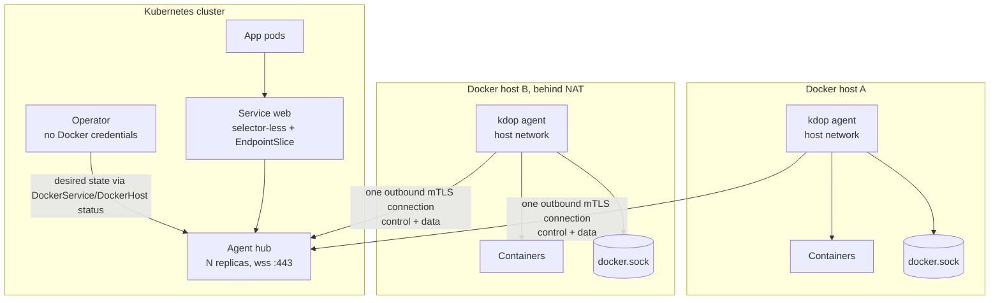
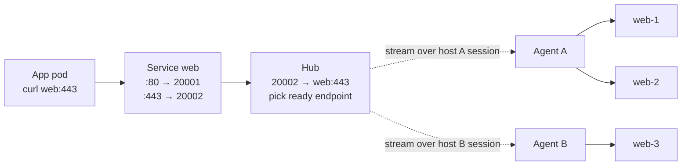

# Design: agent-per-host with a central hub

| | |
|---|---|
| Status | Proposed |
| Replaces | Per-service tunnel server/client, direct Docker API access from the operator |
| Related | [../architecture.md](../architecture.md) (current state, gap IDs `S*`, `C*`, `P*`, `W*`) |

## Problem

The current design has two root causes behind most known gaps:

1. **The control plane is inbound.** The operator calls each Docker daemon over the network. Hosts behind NAT cannot be managed, and the cluster holds root-equivalent credentials for every host (S8, W1).
2. **The data plane knows services, not hosts.** One tunnel server and one tunnel client are created per `DockerService`. Because of that, multiple ports (C1), multiple hosts (C2, W9), remote gateways (C3) and HA (P2, W7) all fail in different ways.

## Goals

- A Kubernetes `Service` can reach containers on Docker hosts, **including hosts behind NAT**.
- One `DockerService` can expose **multiple ports** and select containers on **multiple hosts**.
- Docker hosts only need **outbound** connectivity to one endpoint (TCP 443).
- The cluster stores no Docker credentials. The Docker socket never leaves the host.
- Keep the existing CRDs and user-facing semantics where possible.

## Non-goals (for this design)

- UDP services.
- Traffic from Docker containers to cluster Services (possible later on the same tunnel).
- Per-container network policy.
- Replacing Go. See [Alternatives](#alternatives-considered).

## Overview



There are three components. All of them are the existing binary, run in different modes.

| Component | Mode | Runs where | Responsibility |
|---|---|---|---|
| Operator | `manager` | K8s | Reconciles CRDs into desired state per host, allocates hub ports, manages Services and EndpointSlices. **Never calls Docker.** |
| Agent hub | `manager hub` | K8s, Deployment with N replicas | Terminates agent connections; relays desired state down and status up; routes service traffic to the right host |
| Agent | `manager agent` | Each Docker host | Reconciles containers against the **local** socket; watches Docker events; reports status; dials containers for incoming streams |

## Data path: multiple ports and multiple hosts

Example: `DockerService web` has ports `80` and `443` and selects `web-1`, `web-2` on host A and `web-3` on host B.



Three rules make this work:

1. **Each service port gets its own hub port.** The operator allocates a port from `20000–29999` for every `(DockerService, port)` pair. When a connection arrives, the hub knows which service and target port it belongs to from the local port alone. This works for any TCP protocol and does not depend on HTTP Host headers or SNI.
2. **Endpoints are `(host, container)`, never IPs.** The hub decides which host to use. The agent resolves the container's current IP at dial time, so container restarts that change the IP do not matter.
3. **One session per host.** All streams for all services on a host share that host's connection. Adding services does not add connections, pods or containers.

### Why a selector-less Service

A Service selector only matches pods **in the same namespace**. Hub pods live in `kdop-system`, while `DockerService` objects live in user namespaces. The operator therefore creates:

- a `Service` named after the `DockerService` (so DNS is `web.<ns>.svc`), with **no selector** and one named port per `spec.ports` entry;
- an `EndpointSlice` (label `endpointslice.kubernetes.io/managed-by: kdop.io.vn`) listing the **hub pod IPs**, with each port's number set to its allocated hub port.

kube-proxy matches Service ports to EndpointSlice ports by name. Port names are therefore required when a service has more than one port, which matches normal Kubernetes rules. The operator watches hub pods and rewrites the slices when hub pods move.

## API changes

```go
// DockerHostSpec
type DockerHostSpec struct {
    // Mode selects how the operator reaches this host.
    // "agent" (default for new hosts): the host runs kdop agent and dials the hub.
    // "direct": legacy, the operator calls the Docker API at HostURL.
    Mode          string `json:"mode,omitempty"`
    HostURL       string `json:"hostURL,omitempty"`       // direct mode only
    TLSSecretName string `json:"tlsSecretName,omitempty"` // direct mode only
}

// DockerHostStatus additions
type DockerHostStatus struct {
    Phase       string             `json:"phase,omitempty"`
    Message     string             `json:"message,omitempty"`
    Connections []HubConnection    `json:"connections,omitempty"` // one entry per hub replica
    Conditions  []metav1.Condition `json:"conditions,omitempty"`  // AgentConnected, ...
}

type HubConnection struct {
    HubPod   string      `json:"hubPod"`
    LastSeen metav1.Time `json:"lastSeen"`
}

// ServicePort: Name becomes required when len(ports) > 1 (validated by webhook/CEL).

// DockerServiceStatus replaces TunnelClients / TunnelServerURL
type DockerServiceStatus struct {
    Ports          []AllocatedPort    `json:"ports,omitempty"`
    Endpoints      []DockerEndpoint   `json:"endpoints,omitempty"`
    ReadyEndpoints int32              `json:"readyEndpoints,omitempty"`
    Conditions     []metav1.Condition `json:"conditions,omitempty"`
}

type AllocatedPort struct {
    Name    string `json:"name"`
    Port    int32  `json:"port"`
    HubPort int32  `json:"hubPort"`
}

type DockerEndpoint struct {
    Host      string `json:"host"`      // DockerHost name
    Container string `json:"container"` // Docker container name
    Ready     bool   `json:"ready"`
}
```

The `ConfigMap tunnel-*-targets`, the `/reload` endpoint, the gateway and the per-service tunnel Deployments are removed.

## Component responsibilities

### Operator

For each `DockerService`:

1. **Allocate hub ports.** Keep existing allocations; allocate missing ones from the free range. Write them to `status.ports` using an optimistic-lock status update (`resourceVersion`); retry on conflict.
2. **Compute endpoints.** List matching `DockerContainer`s across all hosts. An endpoint is `ready` only if all of these hold:
   - container `state == running`;
   - `health` is `none` or `healthy`;
   - the host's `AgentConnected` condition is `True`.
3. **Reconcile the `Service` and `EndpointSlice`** as described above.
4. **Set conditions**: `Ready` (at least one ready endpoint), `PortsAllocated`, `Degraded` (some endpoints not ready).

For `DockerContainer` and `DockerJob`, the operator no longer calls Docker. It validates the spec and relies on the agent of `dockerHostRef` to apply it and report status.

### Hub

- **Agent connections.** Accept `wss://` on 443 and require a client certificate. The certificate's identity (`<namespace>/<dockerhost>`) is the host ID. A second connection for the same host ID from the same agent replaces the first.
- **Control stream.** On each session, open a bidirectional gRPC stream:
  - hub → agent: the full desired state for that host (containers and jobs), then incremental updates. The hub reads it from an informer on `DockerContainer`/`DockerJob` filtered by `dockerHostRef`.
  - agent → hub: container status and Docker events. The hub writes them to the CR's `status`, **only for objects assigned to that host ID**.
- **Routing table.** Built from an informer on `DockerService`: `hubPort → (service, targetPort, endpoints)`. It updates on watch events; there is no polling.
- **Connection handling** (per accepted TCP connection on a hub port):

```text
route := table[localPort]
for ep in route.service.nextReady():        // per-service round-robin
    sess := sessions[ep.Host]
    if sess == nil: continue                 // host not connected to this replica
    stream := sess.OpenTimeout(2s)
    write Header{Service: uid, Container: ep.Container, Port: route.targetPort}
    if readAck(stream, 2s) == OK:
        pipe(conn, stream); return
    stream.Close()                           // try the next endpoint
conn.Close()                                 // no ready endpoint
```

Retries happen only **before the first byte** is forwarded, so they are invisible to clients.

- **HA.** Run N replicas behind one external LoadBalancer or NodePort. On connect, each agent learns the replica ID and the replica count. It keeps dialing until it holds one session to **every** replica. This is the same approach as Kubernetes' Konnectivity (apiserver-network-proxy). As a result, any replica that receives a service connection has a session to every host.

### Agent

- Runs with `network_mode: host` and the local Docker socket mounted.
- **Reconciles locally.** The existing `syncContainer`, `needsRecreate` and job logic moves here. Every container it creates gets these labels: `kdop.io.vn/managed=true`, `kdop.io.vn/uid=<CR uid>`, `kdop.io.vn/namespace`, `kdop.io.vn/name`.
- **Watches Docker events** instead of polling and pushes status changes immediately.
- **Garbage-collects** managed containers whose CR UID is no longer in the desired state, but only after a full desired-state sync, never on partial data.
- **Dials containers for incoming streams:**
  - It only accepts a `Header` that names a container with `kdop.io.vn/managed=true` belonging to a service the hub is allowed to route. Raw IPs are rejected.
  - It resolves the IP with `ContainerInspect` at dial time; for host-network containers it dials `127.0.0.1:port`.
- **Local policy file** (`/etc/kdop/policy.yaml`, owned by the host admin) is enforced before creating any container. Example rules: allowed `hostPath` prefixes, registry allowlist, deny privileged. This limits what a compromised control plane can do (see worst case PW2).
- **Reconnects** with exponential backoff and jitter (1s → 60s).

## Host enrollment and identity

1. The admin creates `DockerHost` with `mode: agent`.
2. The operator creates a one-time bootstrap token Secret with a 24h expiry.
3. The admin runs the agent on the host:

   ```bash
   docker run -d --name kdop-agent --network host --restart always \
     -v /var/run/docker.sock:/var/run/docker.sock -v /var/lib/kdop:/var/lib/kdop \
     IMAGE agent --hub wss://hub.example.com --token <bootstrap-token>
   ```

4. The hub validates the token and signs a client certificate with CN `<namespace>/<dockerhost>` and a 30-day lifetime, using the hub CA stored in `kdop-system`. The token is then marked as used.
5. The agent stores the certificate in `/var/lib/kdop` and renews it after two thirds of its lifetime. Revoking a host means deleting the `DockerHost`: the hub drops its session and refuses its certificate (deny list keyed by certificate serial).

## Protocol

| Channel | Transport | Format |
|---|---|---|
| Session | WebSocket over TLS (`wss://`), mTLS | yamux on top of the WebSocket (reuses `internal/tunnel/conn.go`) |
| Control | First yamux stream, opened by the agent | gRPC bidi stream: `Hub.Connect(stream AgentMsg) returns (stream HubMsg)` |
| Data | One yamux stream per TCP connection, opened by the hub | Length-prefixed protobuf `Header{service_uid, container, port}`, then a 1-byte ack (`0` OK, non-zero error code), then raw bytes |

The protocol is defined in protobuf and is language-neutral, so an agent could be rewritten (for example in Rust, for very small devices) without touching the operator or the hub.

## Failure handling

| Event | Behaviour |
|---|---|
| Container added or becomes healthy | Agent reports the event → operator updates `status.endpoints` → hub routing table updates through its watch. Takes seconds |
| Container stops | Same path; marked not ready. Existing connections to it break, as they would for a pod |
| Host loses network | yamux keepalive (10s interval) closes the session; the host's endpoints are skipped immediately by that replica and marked not ready by the operator shortly after. In-flight connections to that host drop |
| Hub replica dies | Agents keep sessions to the other replicas; the EndpointSlice drops the dead pod IP. Connections through that replica drop |
| Operator down | No spec changes are applied, but traffic keeps flowing on the last known routing table, and agents keep containers running |
| Agent offline for a long time while specs change | Containers keep their last applied state. On reconnect the agent receives the full desired state, converges, and garbage-collects removed CRs |
| Two `DockerService`s both use port 80 | No conflict: they get different hub ports |
| Hub port allocation race | Optimistic lock on status; the loser retries with the next free port |

## Gaps that remain after this design

These are accepted limitations, not bugs.

| ID | Gap | Notes / possible follow-up |
|---|---|---|
| G1 | TCP only | UDP needs datagram framing over the session, or QUIC |
| G2 | One TCP connection per host per hub replica: head-of-line blocking; a large transfer slows other services on that host | Move the session to QUIC; or allow several sessions per host |
| G3 | Client source IP is lost | Optionally send PROXY protocol v2 to the container |
| G4 | Extra hop: all traffic goes through the hub and over the WAN | Expected for NAT traversal; hub egress bandwidth must be sized |
| G5 | All endpoints of a service share one `targetPort` | Same as Kubernetes Services |
| G6 | No Docker → cluster direction | Can be added: agent listens locally, hub dials the cluster Service |
| G7 | Hub port range limits a cluster to ~10k service ports | Widen the range or shard hubs |
| G8 | Each host needs a manual agent install with a bootstrap token | Could be scripted (cloud-init) |
| G9 | `direct` mode keeps all current direct-mode gaps (S8, C7) | Keep it for local/Kind development only; deprecate later |

## Worst-case scenarios (proposed design)

Compare with `W1`–`W13` in [../architecture.md](../architecture.md#worst-case-scenarios).

| # | Scenario | What happens | Blast radius | Mitigation |
|---|---|---|---|---|
| PW1 | Hub compromised | Attacker can open streams to any **managed container port** on every connected host and read or modify service traffic. It cannot call the Docker API and cannot dial non-managed addresses | Traffic of all Docker-backed services | Separate ServiceAccount with minimal RBAC; NetworkPolicy; end-to-end TLS inside applications for sensitive traffic |
| PW2 | Operator or K8s API compromised | Attacker can push malicious specs (for example a `hostPath: /` mount) that agents will apply. **Control-plane compromise is still fleet compromise** unless the agent refuses | Every host | Agent-side policy file owned by the host admin; admission webhook in the cluster; image registry allowlist |
| PW3 | One agent or host compromised | Attacker can report false status and receive traffic for services that have endpoints on **that host only**. The hub rejects status for objects not assigned to the certificate's host ID | Services with endpoints on that host | Certificate identity bound to `DockerHost`; revoke by deleting the `DockerHost` |
| PW4 | All hub replicas down | Every Docker-backed `Service` is unreachable. Containers keep running; agents keep enforcing their last known state | All Docker-backed services (data plane only) | ≥ 2 replicas across nodes; PodDisruptionBudget; alert on `ReadyEndpoints == 0` |
| PW5 | Hub restart, 1000+ agents reconnect at once | Thundering herd: TLS handshakes and full desired-state syncs spike CPU and API reads | Hub and API server | Jittered backoff; per-replica accept rate limit; desired state served from the informer cache |
| PW6 | Host partition during the keepalive detection window | New connections routed to that host time out (2s open timeout) before failing over; in-flight connections drop | Services with endpoints on that host, for ~10–30s | Open/ack timeouts plus retry-before-first-byte; tune keepalive |
| PW7 | Hub CA or certificate expiry mishandled | All agents fail to reconnect at the same time | **Whole data and control plane** | Renew at 2/3 lifetime; alert 7 days before expiry; CA rotation with an overlapping bundle |
| PW8 | Large transfer on one host | Head-of-line blocking on the shared session (G2) | Latency for all services on that host | QUIC later; per-stream flow control in yamux (window size) |
| PW9 | Hub pods rescheduled faster than the EndpointSlice update | Short burst of refused connections | Services in the cluster, for seconds | Operator watches hub pods; readiness gates on hub pods; `preStop` delay |
| PW10 | Agent garbage-collects with stale desired state | Containers deleted by mistake | Workloads on one host | GC only after a complete sync acknowledged by the hub; never on an empty or partial list; dry-run log first |

## Rollout plan

The current code keeps working throughout. Each phase is shippable on its own.

### Phase 1: foundation (on the current architecture)

- Fix S1–S7 and S9 (gateway allowlist, `/reload` auth, `wss://`, no root, narrower RBAC, `hostPath` policy via webhook).
- Ownership labels on Docker containers; namespace-aware names (C8); orphan GC.
- Docker events instead of polling (P1); fix C4, C5, C7, C10–C15.
- Build tags for integration tests (T1); unit tests for `internal/tunnel` (T2).

### Phase 2: one session per host (data plane)

- Introduce the hub and the agent's data-plane part; selector-less Services and EndpointSlices; hub port allocation.
- Fixes C1, C2, C3, P2, P3, W7, W9. Removes the gateway (S1), `/reload` (S3) and per-service tunnels.

### Phase 3: control plane through the agent

- Agent applies desired state locally; `DockerHost.mode: agent` becomes the default; enrollment flow.
- Fixes S8 and W1 (no Docker credentials in the cluster), C7 for agent hosts, and NAT for the control plane.
- `direct` mode stays for local/Kind development.

## PoC scope and success criteria

The PoC proves Phase 2 only (data plane):

- One `DockerService` with 2 ports (`80`, `443`) selecting 3 containers on 2 Docker hosts. Use Kind plus one external host, or two Docker-in-Docker hosts with no inbound route.
- 1 hub replica, 1 agent per host. Desired state can still come from the current direct-mode reconcilers.

It passes if:

1. `curl` from a pod to `web:80` and `web:443` succeeds; over 300 requests, each of the 3 containers serves between 25% and 40%.
2. With the agent on host B stopped, all requests succeed through host A within 30s, and no request fails after the session closes.
3. A host with no inbound connectivity serves traffic.
4. Adding a fourth container makes it receive traffic within 5s, without restarting anything.

## Alternatives considered

| Option | Why not (for now) |
|---|---|
| Keep per-service tunnels, fix bugs only | Does not fix NAT for the control plane, credential centralisation, or resource growth per service |
| virtual-kubelet with a Docker provider | Native Pods and Services, but loses the plain-Docker workload model; Services still need a data path to NATed hosts |
| Overlay network (Tailscale, Headscale, Netbird, WireGuard) | Removes the custom tunnel, but adds a hard dependency on an overlay and its key management for every host and the cluster |
| Rewrite in Rust | The gaps above are design and logic issues that a new language does not fix. The Kubernetes and Docker tooling (controller-runtime, kubebuilder, moby, Konnectivity) is Go. A Go agent at ~10–20 MB RSS already fits the target devices. The language-neutral protocol keeps a Rust agent possible later, if measurements on real devices call for it |
