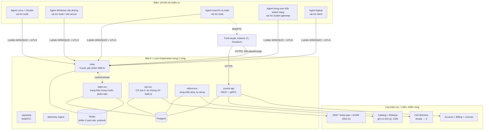
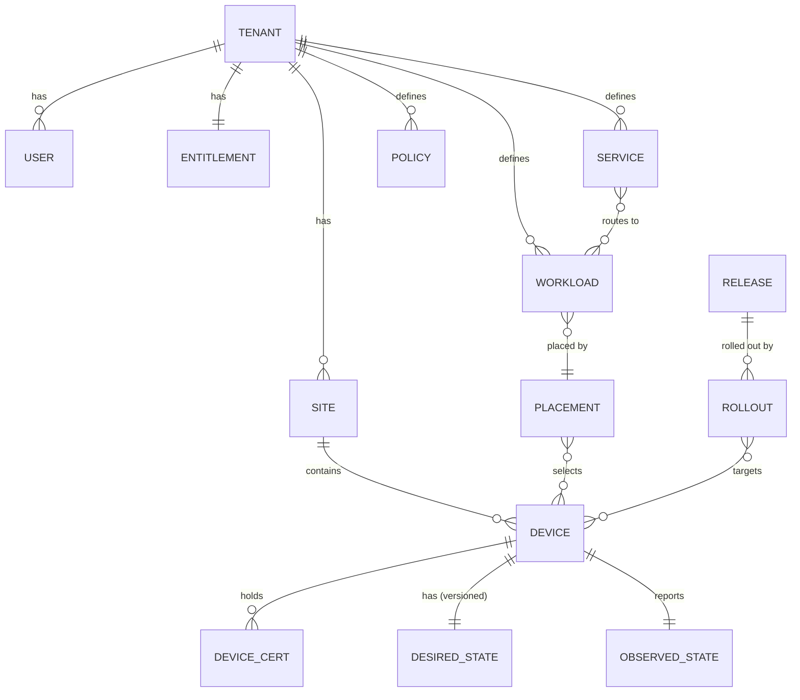
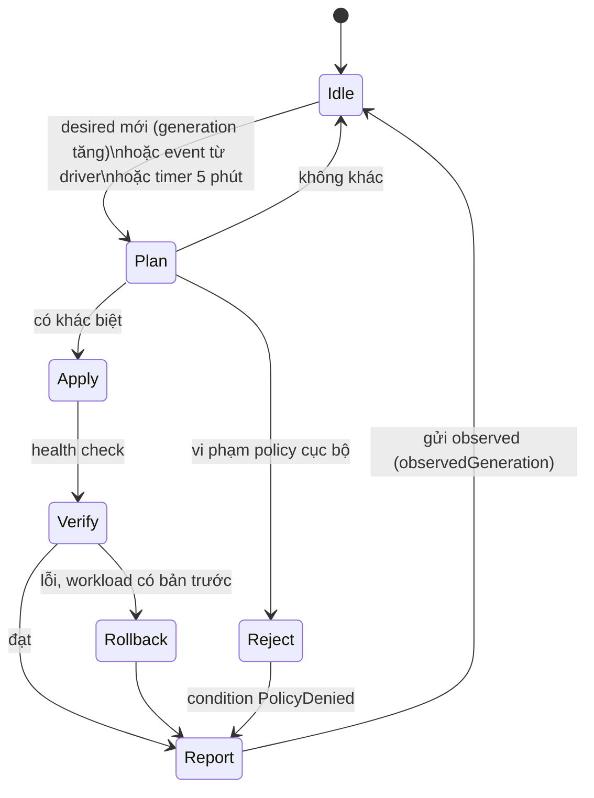
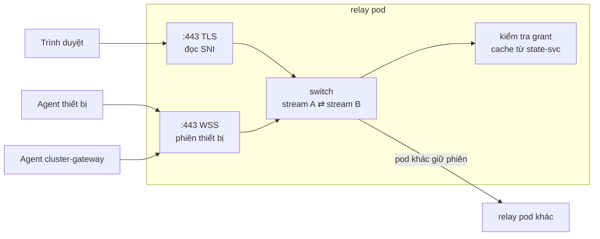
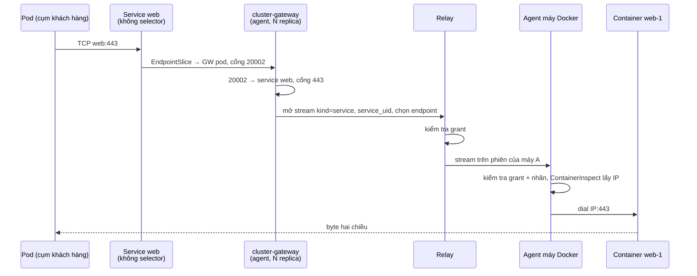
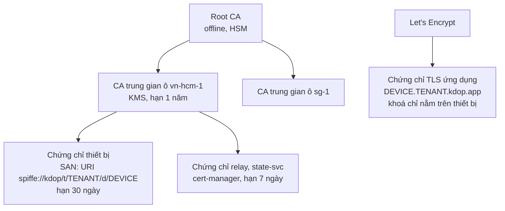
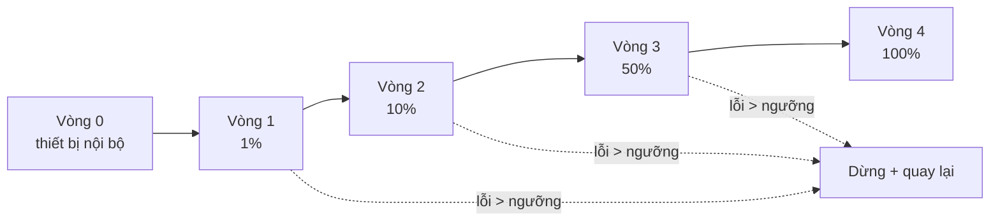
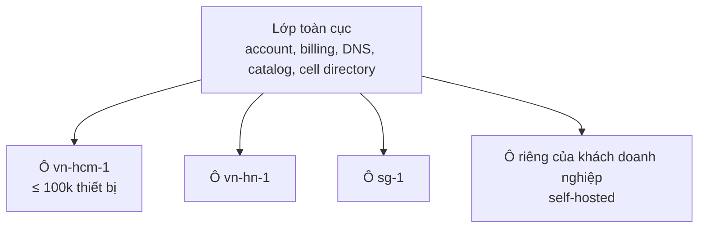

# Thiết kế hệ thống: kdop Platform

| | |
|---|---|
| Trạng thái | Đề xuất |
| Kế thừa | [agent-hub.md](agent-hub.md) (agent mỗi máy, một phiên chiều ra), [kdop-personal.md](kdop-personal.md) (relay SNI, license, passkey), [../poc/office-it-box.md](../poc/office-it-box.md) (sao lưu văn phòng) |
| Thay cho | Operator gọi Docker API trực tiếp và tunnel theo từng service ([../architecture.md](../architecture.md)) |
| Mã lỗ hổng | `S*`, `C*`, `P*`, `W*` trong [../architecture.md](../architecture.md); `G*`, `PW*` trong [agent-hub.md](agent-hub.md) |

## 1. Bài toán

Ba hướng đang được thiết kế riêng rẽ thực chất dùng chung một lõi:

| Hướng | Thiết bị | Workload | Người truy cập |
|---|---|---|---|
| **Fleet** (operator hiện tại) | Máy Linux chạy Docker, ở edge hoặc sau NAT | Container | Pod trong Kubernetes |
| **Office** | Máy Windows trong văn phòng | Sao lưu, cập nhật phần mềm, quét dữ liệu | Chủ văn phòng (trang tổng quan, email) |
| **Personal** | Máy Windows, macOS của cá nhân | App native (Ổ file, AI chat) | Chủ máy và người nhận link, qua trình duyệt |

Cả ba đều cần: **định danh thiết bị, một kết nối chiều ra, trạng thái mong muốn đẩy xuống, trạng thái thực tế báo lên, chuyển tiếp lưu lượng tới thiết bị, cập nhật an toàn và chính sách cục bộ**. Làm ba lần là ba lần mắc cùng lỗi.

Tài liệu này thiết kế **một nền tảng** cho cả ba. Mỗi dòng sản phẩm chỉ là một **bộ workload và giao diện** chạy trên lõi đó.

## 2. Mục tiêu và giới hạn

### Mục tiêu

| # | Mục tiêu | Đo bằng |
|---|---|---|
| M1 | Thiết bị chỉ cần đi ra được TCP 443 | Chạy được sau CGNAT, proxy công ty |
| M2 | Nhà cung cấp không giữ khoá root của thiết bị, không đọc được dữ liệu người dùng | Không có credential Docker/SSH trên cloud; TLS ứng dụng kết thúc tại thiết bị |
| M3 | Thiết bị vẫn chạy đúng khi mất kết nối tới cloud | Workload chạy theo trạng thái mong muốn gần nhất |
| M4 | Một hệ thống phục vụ từ 1 thiết bị (self-host) đến 1 triệu thiết bị (SaaS) | Cùng mã nguồn, khác cách triển khai |
| M5 | Mọi thay đổi trên fleet đều có phiên bản, triển khai dần và quay lại được | Rollout theo vòng, tự dừng khi lỗi |
| M6 | Người dùng thấy được mọi dữ liệu rời khỏi thiết bị | Log egress cục bộ |

### Ngoài phạm vi (giai đoạn này)

- Thay thế Kubernetes cho workload trong datacenter.
- Mạng overlay đầy đủ kiểu Tailscale (định tuyến IP tuỳ ý giữa mọi máy).
- UDP qua relay (xem [G1](agent-hub.md#gaps-that-remain-after-this-design)); WebRTC đã lo phần media P2P cho Personal.
- Thiết bị nhúng không chạy được Go (dưới ~32 MB RAM).

## 3. Nguyên tắc thiết kế

1. **Mọi thứ ở biên đều là agent.** Máy Docker, máy văn phòng, laptop cá nhân, và cả **cổng vào của một cụm Kubernetes** đều là một agent có vai trò khác nhau. Relay chỉ biết "phiên của danh tính X".
2. **Một thiết bị, một phiên.** Mọi luồng điều khiển và dữ liệu của thiết bị đi chung một phiên mTLS (yamux trên WSS, sau này QUIC).
3. **Nguồn sự thật nằm ở control plane, việc thực thi nằm ở agent.** Cloud không bao giờ gọi Docker, Windows service hay launchd. Agent tự reconcile.
4. **Agent có quyền từ chối.** Chính sách cục bộ do chủ thiết bị đặt luôn thắng lệnh từ cloud. Mất control plane không đồng nghĩa mất fleet ([PW2](agent-hub.md#worst-case-scenarios-proposed-design)).
5. **Kubernetes là nơi chạy nền tảng và là một giao diện, không phải kho thiết bị.** Thiết bị, tenant, trạng thái mong muốn nằm trong Postgres. CRD là một frontend như dashboard, API, Terraform.
6. **Chia ô (cell) ngay từ đầu.** Sự cố hoặc tải ở một ô không lan sang ô khác.
7. **Tạm khoá, không xoá.** Hết hạn, hạ gói, mất kết nối đều không làm mất dữ liệu.

## 4. Kiến trúc tổng thể



### 4.1 Thành phần

| Thành phần | Lớp | Trạng thái | Việc chính |
|---|---|---|---|
| `agent` | Biên | SQLite cục bộ | Giữ phiên, reconcile workload qua driver, áp chính sách cục bộ, mở luồng tới workload, log egress, tự cập nhật |
| `relay` | Ô, data plane | Không bền (bảng phiên trong Redis) | Nhận phiên thiết bị; chuyển luồng giữa các phiên; SNI passthrough cho trình duyệt; đếm băng thông |
| `state-svc` | Ô, control plane | Postgres | Lưu trạng thái mong muốn theo thiết bị, có `generation`; đẩy xuống qua phiên; nhận trạng thái thực tế |
| `control-api` | Ô | Postgres | API công khai: tenant, site, thiết bị, workload, service, chính sách, rollout, token đăng ký |
| `pki-svc` | Ô | Postgres + KMS | CA trung gian của ô; ký chứng chỉ thiết bị từ CSR; danh sách thu hồi |
| `rollout-svc` | Ô | Postgres | Triển khai release theo vòng; đọc health để tự dừng hoặc quay lại |
| `signaling` | Ô | Không bền | Trao đổi SDP/ICE cho WebRTC |
| `telemetry` | Ô | Prometheus/VictoriaMetrics, Loki | Nhận metric đã gom và log được phép gửi |
| `k8s-bridge` | Cụm K8s khách hàng | Không | Dịch CRD `kdop.io.vn` thành gọi `control-api`; tạo Service + EndpointSlice trỏ về `cluster-gateway` |
| Lớp toàn cục | Toàn cục | Postgres riêng | Tài khoản, license, thanh toán, DNS, catalog, thư mục ô |

## 5. Mô hình miền



| Thực thể | Ý nghĩa | Ví dụ |
|---|---|---|
| `Tenant` | Đơn vị tính tiền và cô lập. Thuộc đúng một ô | Công ty A, văn phòng kế toán B, người dùng cá nhân C |
| `Site` | Nhóm thiết bị theo vị trí hoặc mạng LAN | "Văn phòng Q1", "Kho Bình Dương", "Nhà" |
| `Device` | Một agent đã đăng ký. Có `role`, nhãn, khả năng (OS, arch, driver có sẵn, RAM, GPU) | `node`, `site-server`, `client`, `cluster-gateway` |
| `Workload` | Thứ cần chạy, độc lập với driver: `container`, `native`, `job`, `builtin` (Ổ file, sao lưu) | Container nginx; app Ollama; job sao lưu 2h sáng |
| `Placement` | Chọn thiết bị cho workload: tên cụ thể, selector nhãn, hoặc `replicas` trên selector | `site=q1, role=node, replicas=3` |
| `Service` | Điểm truy cập ổn định tới một tập workload, nhiều cổng | `web:80,443` trên 3 container ở 2 máy |
| `Policy` | Luật áp ở hai nơi: control plane (admission) và agent (từ chối cục bộ) | Cấm `privileged`, chỉ registry `ghcr.io/acme/*` |
| `Release` | Phiên bản có chữ ký của agent, app, hoặc gói cấu hình | `agent 1.8.2`, `ollama-app 0.5.1` |
| `Rollout` | Đưa một release tới tập thiết bị theo vòng | 1% → 10% → 50% → 100%, dừng nếu lỗi > 2% |

**Lưu trữ.** Postgres là nguồn sự thật. Bảng lớn nhất là `device` và `observed_state` (một dòng mỗi thiết bị, cập nhật khi có thay đổi, không phải mỗi lần heartbeat). Heartbeat chỉ cập nhật Redis; `last_seen` được ghi xuống Postgres theo lô mỗi 60s.

## 6. Agent

### 6.1 Cấu trúc

```text
agent
├── core
│   ├── identity     khoá Ed25519/ECDSA trong kho bảo mật OS (TPM, DPAPI, Keychain, file 0600 trên Linux)
│   ├── session      WSS + yamux tới relay; backoff có jitter; nhiều relay khi HA
│   ├── control      gRPC stream: nhận desired state, gửi observed state + event
│   ├── store        SQLite: desired state gần nhất, observed state, egress log, hàng đợi event
│   ├── policy       /etc/kdop/policy.yaml (hoặc tương đương trên Windows/macOS), do chủ máy sở hữu
│   ├── reconciler   vòng lặp: desired × policy × thực tế → hành động qua driver
│   ├── streams      nhận luồng từ relay, kiểm tra quyền, dial tới workload
│   ├── egress       ghi mọi dữ liệu gửi ra ngoài
│   └── updater      tự cập nhật theo release có chữ ký, A/B, quay lại khi lỗi
├── drivers
│   ├── docker       Docker Engine API qua socket cục bộ (mã từ dockercontainer/dockerjob hiện tại)
│   ├── native       Windows service, launchd, systemd
│   └── builtin      chạy trong tiến trình agent
└── builtins
    ├── files        Ổ file + link chia sẻ (Personal)
    ├── backup       restic + rest-server append-only (Office)
    ├── inventory    phần mềm, bản vá, phần cứng
    ├── scanner      quét dữ liệu cá nhân, chỉ gửi số liệu tổng hợp
    └── webui        giao diện web của thiết bị, xác thực bằng passkey
```

Agent là **một binary Go** cho Linux (amd64, arm64, armv7), Windows (amd64), macOS (arm64, amd64). Driver và builtin được bật theo `role` và khả năng của máy. RAM mục tiêu khi rảnh: ≤ 30 MB.

### 6.2 Vòng reconcile



Quy tắc:

- Mỗi workload agent tạo ra đều mang nhãn `kdop.io.vn/workload-uid` và `kdop.io.vn/tenant`. Agent **chỉ đụng tới thứ có nhãn của mình** (sửa C8, W11).
- So khớp dựa trên **băm của spec đã chuẩn hoá** (gồm env đã giải secret, volume, port, healthcheck), không so từng trường (sửa C6, W12).
- Dọn rác chỉ chạy sau khi nhận **desired state đầy đủ** có `generation` mới hơn lần dọn trước, và không bao giờ trên danh sách rỗng trừ khi hub gửi cờ `explicitEmpty` ([PW10](agent-hub.md#worst-case-scenarios-proposed-design)).
- Secret được đẩy xuống mã hoá bằng khoá công khai của thiết bị, lưu trong SQLite đã mã hoá, không ghi ra log.
- Theo dõi event của Docker / Service Control Manager / launchd thay cho poll (sửa P1, W13).

### 6.3 Chính sách cục bộ

```yaml
# /etc/kdop/policy.yaml — cloud không ghi được file này
apiVersion: kdop.io.vn/v1
kind: LocalPolicy
deny:
  privileged: true
  hostNetwork: false
  capabilities: [SYS_ADMIN, NET_ADMIN]
allow:
  registries: ["ghcr.io/acme/*", "registry.kdop.app/catalog/*"]
  hostPaths: ["/srv/data/*"]
  exposePorts: true
streams:
  allowFrom: [tenant]          # chỉ luồng do service của tenant này mở
maintenance:
  window: "Sun 01:00-04:00"    # cập nhật agent và workload chỉ trong khung này
```

Policy ở control plane (admission) chặn sớm để người dùng thấy lỗi ngay. Policy cục bộ là chốt cuối khi control plane bị chiếm (S7, W5, PW2).

## 7. Mặt phẳng kết nối

### 7.1 Phiên

| Lớp | Giai đoạn đầu | Sau này |
|---|---|---|
| Vận chuyển | WSS qua TCP 443, mTLS | QUIC (UDP 443), tự lùi về WSS khi UDP bị chặn |
| Ghép kênh | yamux (tái dùng `internal/tunnel/conn.go`) | Stream của QUIC (hết head-of-line, [G2](agent-hub.md#gaps-that-remain-after-this-design)) |
| Stream 0 | gRPC `Control.Connect` hai chiều | Như cũ |
| Stream dữ liệu | `Header{kind, service_uid, workload_uid, port, src}` + 1 byte ack + byte thô | Như cũ |

Keepalive 15s, đóng phiên sau 3 lần mất. Agent kết nối lại với backoff 1s → 60s có jitter; relay giới hạn tốc độ nhận phiên mới mỗi pod ([PW5](agent-hub.md#worst-case-scenarios-proposed-design)).

### 7.2 Relay

Relay là một bộ chuyển luồng giữa các **danh tính**, không biết workload là gì.



Ba kiểu luồng, cùng một cơ chế:

| Kiểu | Nguồn | Đích | Định tuyến theo | Dùng cho |
|---|---|---|---|---|
| `sni` | Trình duyệt | Thiết bị | SNI `<thiết bị>.<tenant>.kdop.app` | Personal: web của máy, link chia sẻ. TLS kết thúc tại agent |
| `service` | Agent `cluster-gateway` | Thiết bị có endpoint | `service_uid` + chọn endpoint sẵn sàng | Fleet: Pod trong K8s gọi container trên máy Docker |
| `peer` | Agent | Agent khác cùng tenant | `device_id` + `port` được cấp | Office: máy nhân viên gửi sao lưu tới site-server khi không chung LAN |

**Grant.** Mỗi luồng phải khớp một grant do `state-svc` sinh ra từ `Service` và `Policy`: `(nguồn, đích, service/port)`. Relay cache grant theo tenant, cập nhật qua Redis pub/sub. Không có grant thì đóng luồng trước byte đầu tiên. Agent đích kiểm tra lại grant lần nữa (phòng relay bị chiếm, [PW1](agent-hub.md#worst-case-scenarios-proposed-design)).

**Nhiều pod.** Redis giữ `device_id → relay_pod`. Pod nhận luồng mà không giữ phiên đích sẽ chuyển nội bộ sang pod đúng qua một kết nối pod-to-pod dùng lại. Cách này rẻ hơn cách của Konnectivity (mỗi agent nối tới mọi pod) khi số pod lớn; đổi lại thêm một bước nhảy trong cụm.

**Ưu tiên đường ngắn.** Theo thứ tự: cùng LAN (mDNS, địa chỉ do hub gửi) → WebRTC/QUIC hole punching → relay. Relay luôn là phương án cuối nhưng luôn có.

### 7.3 Truy cập từ Kubernetes (Fleet)

Giữ nguyên ý tưởng của [agent-hub.md](agent-hub.md), chỉ đổi "hub" thành **agent vai trò `cluster-gateway`** chạy trong cụm của khách hàng:



- Khi cụm khách hàng **cùng ô** với relay (self-hosted), `cluster-gateway` và relay có thể chạy chung tiến trình, bỏ một bước nhảy.
- `k8s-bridge` tạo Service không selector + EndpointSlice trỏ về pod `cluster-gateway`, cấp cổng từ dải `20000–29999` cho mỗi `(service, port)`. Sửa C1, C2, C3, P2, W7, W9.
- Chiều ngược lại (container gọi Service trong cụm, [G6](agent-hub.md#gaps-that-remain-after-this-design)): agent mở cổng cục bộ `127.0.0.1:<port>`, luồng `kind=service` đi ngược về `cluster-gateway`, gateway dial Service. Cùng cơ chế grant.

## 8. Mặt phẳng điều khiển

### 8.1 Trạng thái mong muốn có phiên bản

```text
DesiredState {
  device_id
  generation        tăng mỗi khi bất kỳ thứ gì của thiết bị đổi
  workloads[]       spec đã giải placement, đã áp policy tenant
  grants[]          luồng nào được vào thiết bị này
  config            cấu hình agent (log level, relay, khung bảo trì)
  agent_release     phiên bản agent mục tiêu (từ rollout)
  secrets_sealed[]  secret mã hoá bằng khoá thiết bị
}
ObservedState {
  device_id
  observed_generation
  workloads[]{uid, phase, health, spec_hash, message, endpoints[]}
  conditions[]      Ready, PolicyDenied, Degraded, UpdatePending
  capabilities      OS, arch, driver, RAM, GPU, đĩa
}
```

Luồng xử lý:

1. Người dùng đổi `Workload`/`Service`/`Policy` qua API, CRD hoặc dashboard.
2. `state-svc` tính lại desired state cho **các thiết bị bị ảnh hưởng** (index ngược `workload → devices`), tăng `generation`, ghi Postgres, phát `device_id` lên Redis.
3. Relay pod đang giữ phiên của thiết bị nhận tin, đẩy desired state xuống qua stream 0. Thiết bị offline thì nhận khi kết nối lại (luôn gửi bản đầy đủ khi mới kết nối, gửi diff khi đang kết nối).
4. Agent reconcile, gửi `ObservedState` có `observed_generation`.
5. API trả về trạng thái tổng hợp: workload `Ready` khi mọi thiết bị được chọn có `observed_generation == generation` và phase tốt.

Operator không còn gọi Docker; mất control plane thì workload vẫn chạy (M3, sửa C7, W8, W10).

### 8.2 Giao diện

| Giao diện | Dùng cho | Ghi chú |
|---|---|---|
| REST + gRPC `control-api` | Mọi thứ khác dựa trên đây | OpenAPI + protobuf trong `pkg/proto` |
| CRD qua `k8s-bridge` | Đội đã dùng GitOps/Argo CD | `DockerContainer`, `DockerDeployment`, `DockerJob`, `DockerService`, `DockerHost` giữ nguyên tên; bridge ánh xạ sang `Workload`/`Placement`/`Service`/`Device`. Status đồng bộ ngược |
| Dashboard web | Office, Personal, quản trị viên | Gọi `control-api` |
| CLI `kdopctl` | Kỹ sư | Đăng ký thiết bị, xem log, mở cổng tạm |
| Terraform provider | Hạ tầng như mã | Sau MVP |

### 8.3 Ánh xạ CRD hiện tại

| CRD hiện tại | Thành |
|---|---|
| `DockerHost` | `Device` (vai trò `node`); `spec.hostURL`/`tlsSecretName` chỉ còn cho chế độ `direct` |
| `DockerContainer` | `Workload{kind: container}` + `Placement{device: dockerHostRef}` |
| `DockerDeployment` | `Workload` + `Placement{selector, replicas}`; rollout theo `maxUnavailable` thay cho chỉ tạo lúc đầu (sửa C9) |
| `DockerJob` | `Workload{kind: job}` |
| `DockerService` | `Service` + EndpointSlice trỏ về `cluster-gateway` |

## 9. Định danh, PKI và quyền

### 9.1 Cây chứng chỉ



- Danh tính thiết bị theo dạng SPIFFE ID. Mọi kiểm tra quyền dựa trên `tenant` và `device` trong chứng chỉ, không dựa vào thứ thiết bị tự khai.
- Gia hạn ở 2/3 thời hạn qua phiên đang mở. Cảnh báo khi còn 7 ngày ([PW7](agent-hub.md#worst-case-scenarios-proposed-design)). Đổi CA trung gian bằng bundle chồng lấn.
- Thu hồi: xoá thiết bị → thêm serial vào danh sách từ chối (Redis, mọi relay đọc) → đóng phiên ngay.

### 9.2 Đăng ký thiết bị

| Cách | Cho ai | Luồng |
|---|---|---|
| Token khởi tạo | Fleet, máy chủ Linux | Admin tạo token dùng một lần, hạn 24h, gắn sẵn site và nhãn; `kdop-agent enroll --token ...` (giống [agent-hub.md](agent-hub.md#host-enrollment-and-identity)) |
| Device code | Personal | Agent hiện mã, người dùng xác nhận trên trình duyệt đã đăng nhập ([kdop-personal.md §4.1](kdop-personal.md)) |
| Mã site | Office | Site-server tạo mã 8 ký tự; máy nhân viên nhập mã, chủ văn phòng duyệt trên dashboard |
| Cloud-init / MDM | Fleet số lượng lớn, công ty | Token khởi tạo dùng nhiều lần, giới hạn số lượng và dải IP nguồn |

Mọi cách đều kết thúc bằng: agent gửi CSR (khoá sinh trên máy) → `pki-svc` kiểm tra chỗ trống trong license → ký chứng chỉ.

### 9.3 Người dùng và quyền

- Đăng nhập: OIDC (Google, Microsoft, SSO doanh nghiệp qua SAML/OIDC ở gói doanh nghiệp).
- RBAC theo tenant: `owner`, `admin`, `operator` (đổi workload), `viewer`, phạm vi theo site.
- Truy cập web của thiết bị (Personal) dùng **passkey đăng ký trên agent**, không dựa vào phiên cloud. Cloud bị chiếm cũng không đăng nhập thay chủ máy được.
- Thao tác nguy hiểm (thêm `hostPath`, mở cổng ra ngoài, đổi policy tenant) cần xác nhận lại và ghi audit log không sửa được.

## 10. Phân phối phần mềm và rollout

### 10.1 Gói

```yaml
apiVersion: kdop.io.vn/v1
kind: Package
metadata: {name: ollama-chat, version: 0.5.1}
requires:
  os: [windows, darwin, linux]
  ram: 8Gi
  gpu: optional
artifacts:
  - {os: windows, arch: amd64, url: ..., sha256: ...}
  - {os: darwin,  arch: arm64, url: ..., sha256: ...}
  - {os: linux,   kind: container, image: registry.kdop.app/catalog/ollama-chat@sha256:...}
run:
  driver: native            # hoặc container
  health: {http: "http://127.0.0.1:11500/health", timeout: 60s}
expose:
  - {name: web, port: 11500, via: [sni, lan]}
signature: cosign / minisign, khoá trong KMS
```

Agent chỉ cài gói có chữ ký hợp lệ với khoá công khai nhúng trong binary hoặc có trong policy cục bộ (doanh nghiệp tự ký gói nội bộ).

### 10.2 Rollout theo vòng



- Mỗi vòng có thời gian quan sát tối thiểu (ví dụ 1h cho agent, 15 phút cho workload).
- Tín hiệu lỗi: agent không kết nối lại sau cập nhật, health check lỗi, tỉ lệ crash, tỉ lệ rollback cục bộ.
- Khung bảo trì của thiết bị luôn được tôn trọng; thiết bị ngoài khung thì chờ.
- Agent tự cập nhật kiểu A/B: giữ binary cũ, nếu bản mới không gửi được `ObservedState` trong 5 phút thì tự quay về.

## 11. Quan sát và vận hành

| Loại | Ở biên | Lên cloud |
|---|---|---|
| Metric | Agent gom theo phút | Chỉ metric của agent và workload đã khai báo, có nhãn tenant; giới hạn số series mỗi thiết bị |
| Log | Lưu cục bộ có xoay vòng | Chỉ khi tenant bật, hoặc mở theo yêu cầu (`kdopctl logs` mở stream qua relay, không lưu trên cloud) |
| Event | Hàng đợi SQLite | Luôn gửi; giữ khi offline, gửi bù |
| Egress log | Luôn bật | Không; người dùng xem tại thiết bị |

SLO đề xuất cho mỗi ô:

| SLO | Mục tiêu |
|---|---|
| Thiết bị online kết nối được relay | 99,95% / tháng |
| Thay đổi desired state tới thiết bị online | p99 < 5s |
| Luồng `service` mở thành công khi có endpoint sẵn sàng | 99,9% |
| Thời gian thiết bị kết nối lại sau khi relay pod chết | p99 < 30s |

## 12. Quy mô và chia ô

### 12.1 Ô (cell)



- Tenant thuộc **một ô nhà**. Thiết bị của tenant chỉ kết nối relay của ô đó (`relay.<ô>.kdop.app`), nhận địa chỉ từ cell directory khi đăng ký.
- Ô là đơn vị triển khai, nâng cấp, và giới hạn sự cố. Lớp toàn cục chết thì ô vẫn chạy (chỉ không đăng ký tenant mới, không thanh toán được).
- Chuyển tenant giữa các ô: sao chép dữ liệu Postgres theo tenant, đổi directory, đẩy `config.relay` mới; agent tự chuyển.
- **Self-hosted** là một ô chạy trong cụm của khách hàng, liên kết với lớp toàn cục chỉ để lấy license (hoặc dùng license offline có chữ ký).

### 12.2 Ước lượng tải (cần đo trong PoC)

| Thông số | Giả định | Hệ quả cho 100k thiết bị/ô |
|---|---|---|
| Bộ nhớ mỗi phiên rảnh (TLS + yamux + buffer) | ~50 KB | ~5 GB tổng; ~20k phiên/pod → 5–8 pod relay |
| Keepalive | 15s | ~6,7k gói/s, không đáng kể |
| Thay đổi desired state | 1%/giờ thiết bị | ~0,3 lần ghi/s vào Postgres |
| Cập nhật observed state | Chỉ khi đổi + 1 lần/giờ | ~30 lần ghi/s |
| Băng thông relay | Phụ thuộc sản phẩm | Personal: hạn mức Free; Fleet: tính tiền theo GB |
| Kết nối lại hàng loạt | 100k trong 60s | ~1,7k bắt tay TLS/s; giới hạn mỗi pod + jitter ở agent |

## 13. Mô hình bảo mật

### 13.1 Ranh giới tin cậy

| Bên | Được tin để | Không được tin để |
|---|---|---|
| Chủ thiết bị (policy cục bộ) | Quyết định cuối cùng trên thiết bị | – |
| Control plane của ô | Phân phối desired state, cấp chứng chỉ | Đọc dữ liệu người dùng; ép thiết bị vượt policy cục bộ |
| Relay | Chuyển byte giữa danh tính đã xác thực | Đọc nội dung (luồng `sni` mã hoá đầu cuối); mở luồng không có grant (agent kiểm tra lại) |
| Agent khác cùng tenant | Gửi luồng theo grant | Báo trạng thái thay thiết bị khác |
| Lớp toàn cục | License, DNS | Truy cập thiết bị (không giữ phiên, không có CA của ô) |

### 13.2 Tình huống xấu nhất

Đối chiếu với `W1–W13` và `PW1–PW10`.

| # | Tình huống | Hậu quả | Giới hạn bởi |
|---|---|---|---|
| X1 | Control plane một ô bị chiếm | Đẩy workload độc hại tới thiết bị của các tenant trong ô | Policy cục bộ (registry, privileged, hostPath); chữ ký gói; giới hạn trong một ô. **Vẫn là sự cố nghiêm trọng nhất**, cần audit và cảnh báo khi policy tenant bị nới |
| X2 | Relay bị chiếm | Đọc được lưu lượng `service` không mã hoá ở tầng ứng dụng; không đọc được `sni` | Agent kiểm tra grant; khuyến nghị TLS trong ứng dụng; relay không giữ CA |
| X3 | CA của ô lộ khoá | Giả mạo thiết bị, giả mạo relay | Khoá trong KMS, không xuất được; CA theo ô nên chỉ một ô bị ảnh hưởng; đổi CA bằng bundle chồng lấn |
| X4 | Lớp toàn cục bị chiếm | Tạo bản ghi DNS, xin chứng chỉ giả cho `*.kdop.app` | Giám sát Certificate Transparency; passkey trên agent nên vẫn không đăng nhập được thay chủ máy |
| X5 | Gói trong catalog bị đầu độc | Mã độc chạy trên nhiều thiết bị | Ký bằng khoá KMS, build tái lập, rollout theo vòng phát hiện sớm |
| X6 | Một thiết bị bị chiếm | Nhận luồng dành cho endpoint trên máy đó; báo trạng thái giả cho chính nó | Chứng chỉ gắn với `device`; grant theo thiết bị; thu hồi tức thì |
| X7 | Toàn bộ relay của ô chết | Mất truy cập từ xa; workload vẫn chạy; LAN và P2P vẫn chạy nếu đã thiết lập | ≥ 3 pod trên nhiều zone, PDB; DNS failover sang relay dự phòng của ô |
| X8 | Cập nhật agent lỗi trên diện rộng | Mất kết nối hàng loạt | A/B tự quay về; rollout theo vòng; vòng 0 nội bộ |

## 14. License và thanh toán

Giữ mô hình trong [kdop-personal.md §1, §4.6–4.7](kdop-personal.md), mở rộng cho Fleet và Office:

| Dòng | Đơn vị tính | Ví dụ |
|---|---|---|
| Personal | Số máy chủ, máy khách; hạn mức relay | Free 1+1, Pro 1+5 |
| Office | Số thiết bị trong site; dung lượng sao lưu cloud | $5–10/văn phòng/tháng |
| Fleet SaaS | Số thiết bị `node`; GB qua relay | Theo bậc |
| Fleet self-hosted | Số thiết bị; license offline có chữ ký, hạn 1 năm | Hợp đồng năm |

Token license là JWT/PASETO có chữ ký, hạn 14 ngày, agent kiểm tra được khi offline. Relay và `pki-svc` kiểm tra license trước khi nhận phiên hoặc ký chứng chỉ. Vượt giới hạn thì tạm khoá thiết bị vượt, không xoá.

## 15. Triển khai nền tảng

| Hình thức | Thành phần | Dùng cho |
|---|---|---|
| **SaaS** | Lớp toàn cục + nhiều ô trên Kubernetes managed; Postgres managed; Redis; KMS | Personal, Office, Fleet nhỏ |
| **Self-hosted** | Một ô (Helm chart): relay, state-svc, control-api, pki-svc, CloudNativePG, Redis; `cluster-gateway` + `k8s-bridge` | Doanh nghiệp, dữ liệu không được rời hạ tầng |
| **Dev** | `kdop dev`: một tiến trình chứa mọi dịch vụ, SQLite, CA tự sinh; Kind + agent trong Docker | Phát triển, CI, demo |

Mọi dịch vụ của ô là **cùng một binary** chạy ở chế độ khác nhau (giống cách `cmd/manager` hiện có các mode `tunnel server|client|gateway`), để chế độ Dev và self-hosted đơn giản.

## 16. Bố cục mã nguồn

```text
cmd/
  kdop/                 # một binary: agent | relay | state | api | pki | rollout | signaling | bridge | dev
  kdopctl/              # CLI
internal/
  agent/{core,drivers/{docker,native,builtin},builtins/{files,backup,inventory,scanner,webui}}
  relay/{session,switch,sni,grant,peer,quota}
  control/{state,api,pki,rollout,signaling,placement,policy}
  bridge/               # CRD → control-api (tách từ internal/controller hiện tại)
  global/{account,license,billing,dns,catalog,directory}
  tunnel/               # giữ: WebSocket + yamux, sửa goroutine ping rò rỉ trong conn.go
pkg/
  proto/                # protobuf: control, stream header, observed/desired state
  api/                  # kiểu Go công khai cho control-api
api/v1alpha1/           # CRD giữ nguyên tên, chuyển dần sang v1beta1
deploy/
  helm/{cell,global,cluster-gateway}
  installers/{windows-msi,macos-pkg,linux-deb-rpm,docker}
```

Tái dùng từ code hiện tại:

| Hiện tại | Đi về |
|---|---|
| `dockercontainer`/`dockerjob` reconciler (`syncContainer`, `needsRecreate`, retry, TTL) | `internal/agent/drivers/docker`, đổi sang socket cục bộ, sửa C6, C12, C15 |
| `dockerservice` (tính endpoint theo selector) | `internal/control/placement` và `internal/bridge` |
| `dockerdeployment` | `internal/control/placement` (replicas, rollout) |
| `internal/tunnel/conn.go` | `internal/relay/session` và `internal/agent/core/session` |
| `gateway.go`, `/reload`, ConfigMap targets, tunnel theo service | **Bỏ** (đóng S1, S3, P3) |

## 17. Lộ trình

Mỗi giai đoạn tự giao được, code hiện tại vẫn chạy trong lúc chuyển.

| Giai đoạn | Thời lượng ước tính | Nội dung | Đóng |
|---|---|---|---|
| **0. Gia cố** | 3–4 tuần | Phase 1 của [agent-hub.md](agent-hub.md#phase-1-foundation-on-the-current-architecture): sửa S1–S9, nhãn sở hữu, event thay poll, build tag test | S*, C4–C15, T1, T2 |
| **1. Lõi phiên + relay** | 4–6 tuần | `pkg/proto`, agent core (session, control, store), relay một pod, `pki-svc`, đăng ký bằng token, `kdop dev` | Nền cho mọi dòng |
| **2. Fleet data plane** | 3–4 tuần | `cluster-gateway`, `k8s-bridge` cho `DockerService`, luồng `service`, grant | C1, C2, C3, P2, W7, W9 (= PoC của [agent-hub.md](agent-hub.md#poc-scope-and-success-criteria)) |
| **3. Fleet control plane** | 4–6 tuần | `state-svc`, driver Docker trong agent, bridge cho mọi CRD, policy cục bộ, dọn rác an toàn | S8, C7, W1, W8, W10 |
| **4. Personal** | 4 tuần | Driver native, builtin `files` + `webui`, luồng `sni`, ACME DNS-01, passkey, device code ([PoC](../poc/personal-server-free.md)) | M2, M6 |
| **5. Vận hành fleet** | 4 tuần | Rollout theo vòng, agent tự cập nhật A/B, telemetry, dashboard | M5 |
| **6. Office** | 6 tuần | Builtin `backup`, `inventory`, `scanner`, luồng `peer`, mã site ([PoC](../poc/office-it-box.md)) | |
| **7. Thương mại + quy mô** | liên tục | Lớp toàn cục (license, billing, directory), nhiều ô, relay nhiều pod, QUIC, WebRTC, Helm self-hosted | G2, PW5 |

Giai đoạn 4 và 6 có thể đổi thứ tự tuỳ dòng nào được chọn làm sản phẩm đầu tiên; cả hai chỉ phụ thuộc giai đoạn 1.

## 18. Quyết định cần chốt

| # | Câu hỏi | Đề xuất | Lý do |
|---|---|---|---|
| D1 | Dòng sản phẩm nào ra trước | Personal hoặc Office trước, Fleet song song ở mức mã nguồn mở | Fleet khó bán lẻ; Personal dễ demo, Office có người trả tiền |
| D2 | Relay chuyển nội bộ giữa pod hay agent nối tới mọi pod | Chuyển nội bộ qua Redis | Số kết nối không tăng theo số pod |
| D3 | Bus sự kiện: Redis pub/sub hay NATS | Redis trước | Ít thành phần; đổi sang NATS JetStream khi cần giao nhận chắc chắn giữa các ô |
| D4 | WSS hay QUIC từ đầu | WSS trước, thiết kế stream header độc lập vận chuyển | Mạng công ty hay chặn UDP; QUIC thêm sau không đổi protocol |
| D5 | Giữ CRD làm nguồn sự thật cho self-hosted? | Không, Postgres cho mọi hình thức | Một đường mã; CRD chỉ là frontend |
| D6 | Mã nguồn mở phần nào | Agent, relay, `k8s-bridge`, giao thức | Khách cần kiểm tra được thứ chạy trên máy họ; lớp toàn cục và catalog giữ đóng |
| D7 | Ngôn ngữ | Go cho mọi thành phần | Xem [agent-hub.md, Alternatives](agent-hub.md#alternatives-considered); giao thức protobuf để có thể viết agent Rust sau |
